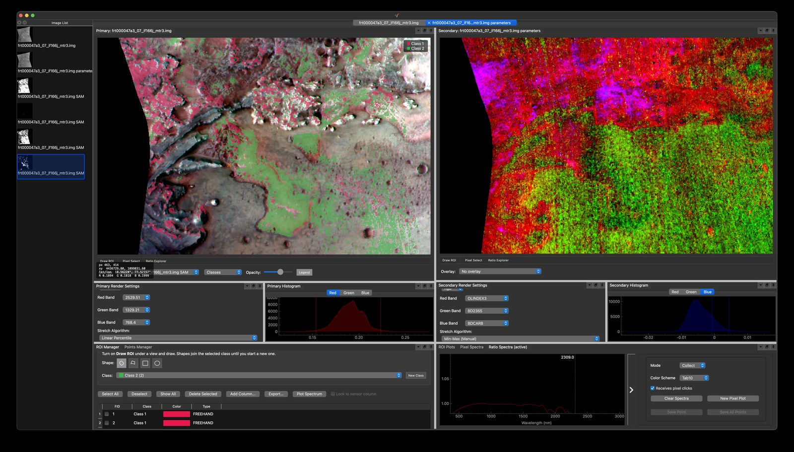
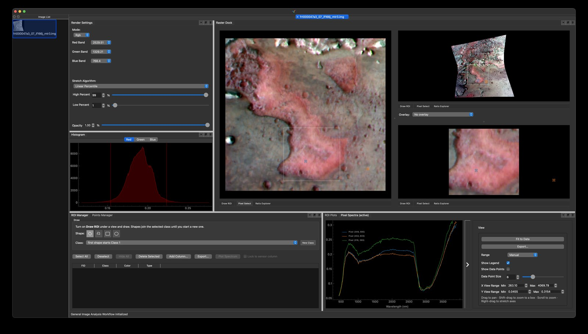
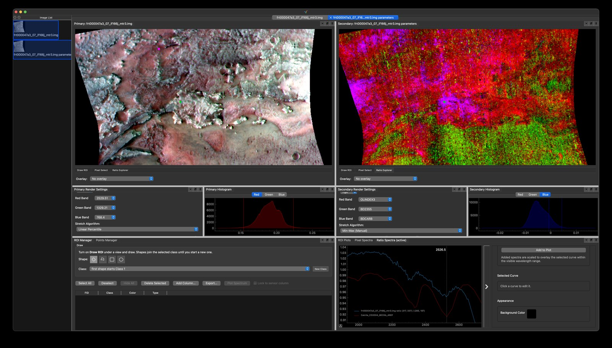

<p align="center">
  <picture>
    <source media="(prefers-color-scheme: dark)" srcset="docs/assets/varda-hero-on-dark.svg">
    <source media="(prefers-color-scheme: light)" srcset="docs/assets/varda-hero-on-light.svg">
    
  </picture>
</p>

Varda is a desktop application for exploring and analyzing hyperspectral and
multispectral images. Open an image, look at it in true or false color,
click any pixel to see its spectrum, outline regions of interest, and run
analyses, without writing code. It is developed at the Space Imagery Center
(Lunar and Planetary Laboratory, University of Arizona) for planetary and
Earth remote sensing work such as CRISM, and its design follows tools like
ENVI Classic and napari.

## See it in action

<p align="center">
  
</p>

<p align="center"><sub>A dual-image workspace: a Spectral Angle Mapper classification over false color (left), beside OLINDEX3 / BD2355 / BDCARB band parameters (right)</sub></p>

| | |
|---|---|
|  |  |
| Click pixels to collect and compare their spectra | The Ratio Explorer: a ratio spectrum against a library calcite spectrum around the 2.3–2.5 µm carbonate bands |

**Spectral Hourglass:** find endmembers with MNF, pixel purity and the n-D
visualizer, identify them against a spectral library, and map them across the
scene (sped up).

https://github.com/user-attachments/assets/2a312f4f-7084-455a-bf0b-c88e766c7d6e

**Classification:** train a small neural network (CNN) on ROI classes and
classify the scene (sped up).

https://github.com/user-attachments/assets/58862020-51f0-4161-bc46-391e288d789b

<sub>CRISM FRT000047A3 (Nili Fossae, Mars), from NASA's Planetary Data System.</sub>

## What you can do with it

- **View images:** ENVI, GeoTIFF and HDF5 cubes, shown in true color, false
  color or one band at a time, with adjustable stretches and color maps.
  Compare two images side by side in linked views, and overlay one on
  another.
- **Explore spectra:** plot pixel spectra and the mean spectra of regions of
  interest, compare them with spectral libraries, and export plots as SVG,
  PDF, PNG or CSV.
- **Work with regions of interest:** draw them on the image, group them into
  classes, and tabulate their statistics.
- **Run analyses:** band math and spectral parameters, continuum removal,
  PCA, MNF and ICA, classification (from maximum likelihood and k-means to
  small neural networks), target and anomaly detection, filtering and more.
  Results join your project as new images, which you can save as ENVI or
  GeoTIFF files.
- **Find and map endmembers** with the Spectral Hourglass, an ENVI-style
  workflow from noise reduction through pixel purity and the n-D visualizer
  to identification against spectral libraries and mapping.
- **Pick up where you left off:** sessions save your images, workspaces and
  regions of interest, and Varda autosaves as you work.

Varda is under active development, so expect rough edges and frequent
changes. Bug reports and feature requests are welcome on the
[issue tracker](https://github.com/varda-pro/Varda/issues/new/choose).

## Getting Varda

**Download:** each release on the
[Releases page](https://github.com/varda-pro/Varda/releases) has a
ready-to-run build for Windows, macOS (Apple silicon) and Linux; no Python
needed.

**From source:** with Python 3.13 and [uv](https://docs.astral.sh/uv/):

```bash
git clone https://github.com/varda-pro/Varda.git
cd Varda
uv sync --extra hypyrameter
uv run varda
```

See [Installing Varda](docs/user-guide/installing.md) for details, including
the first launch on macOS and the optional extras.

## Documentation

The [user guide](docs/user-guide/README.md) covers Varda's features in
detail: sessions and saving, choosing PCA/MNF components, the Spectral
Hourglass and spectral libraries, and optional features such as PyTorch
classifiers. In the app, **Help → Documentation** opens it.

## Citing Varda

If Varda helps your research, please cite it: GitHub's **Cite this
repository** button (from [CITATION.cff](CITATION.cff)) gives APA and BibTeX,
and so does **Help → Cite Varda** in the app. A DOI for each release will
follow.

## Contributing and license

Bug reports, ideas and pull requests are welcome; see
[CONTRIBUTING.md](CONTRIBUTING.md) and the [code of conduct](CODE_OF_CONDUCT.md).

Varda is free software under the [GNU General Public License v3 or later](LICENSE).
Developed at the Space Imagery Center, Lunar and Planetary Laboratory,
University of Arizona.
